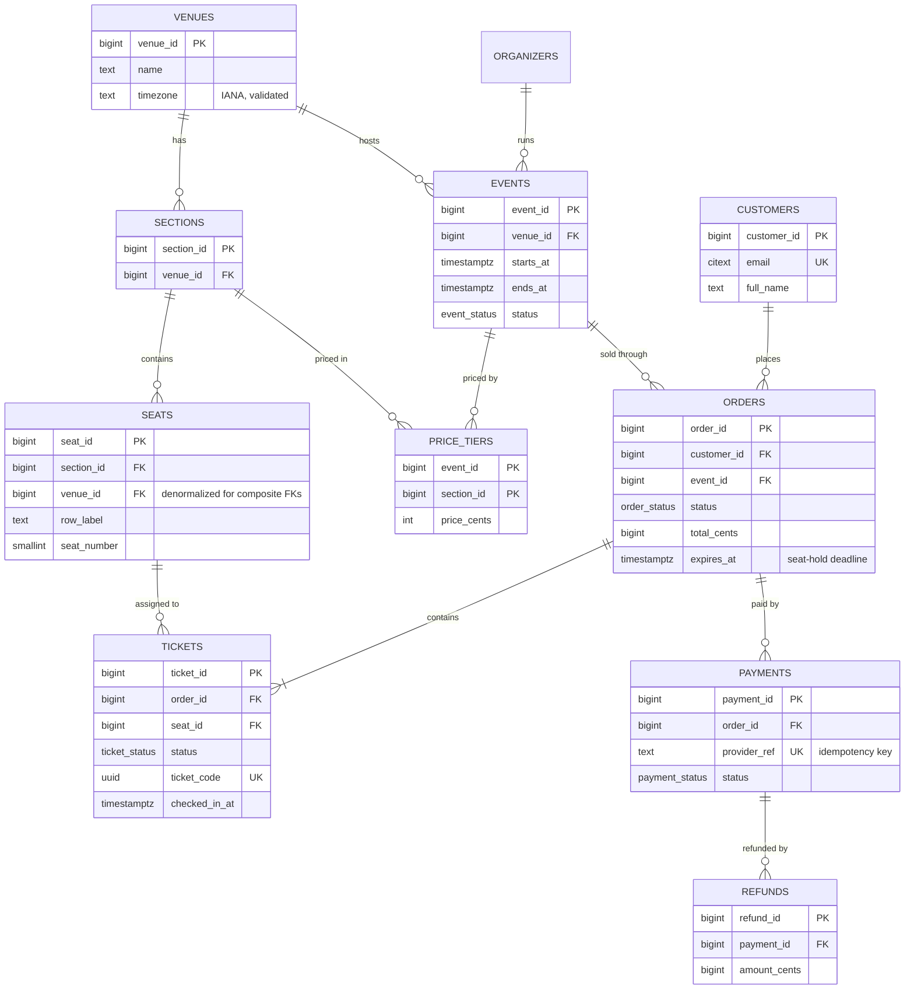

# 🎟️ StageDB: a concurrency-safe event ticketing database


StageDB is the database layer for a Ticketmaster-style platform: venues, seat maps, events, time-limited seat holds, payments, refunds and gate check-in. It's built in **pure PostgreSQL**.

The hard part of ticketing is **concurrency**. When thousands of people click "Buy" on the same seats at the same moment, each seat still has to be sold exactly once. StageDB enforces that rule *inside the database*, through constraints, so no application bug can break it. It ships with tests that prove it.

```
50 sessions race for the same 2 seats  →  won=1  lost=49  double-bookings=0
pgbench, 32 clients, 30 s               →  ~1,300 checkout txns/sec, 0 seats sold twice
```

---

## Highlights

| Area | What's in it |
|---|---|
| **Data model** | 11 normalized (3NF) tables, 5 enum types, composite foreign keys that make cross-venue mistakes *unrepresentable* |
| **Integrity** | Partial unique index (no double-selling), `EXCLUDE USING gist` (no overlapping events per venue), CHECK constraints, append-only financial ledger |
| **Transactional API** | 9 `SECURITY DEFINER` PL/pgSQL functions: reserve → pay → refund / cancel / check-in, with stable custom error codes |
| **Concurrency** | Row locks with consistent lock ordering (deadlock-free), `FOR UPDATE SKIP LOCKED` sweeper, lazy expiry of lapsed holds, idempotent payment webhooks |
| **State machines** | Trigger-enforced lifecycles for events, orders and tickets; illegal transitions are rejected |
| **Auditing** | Generic audit trigger storing column-level diffs as JSONB in a **monthly range-partitioned** table |
| **Security** | Least-privilege roles, **Row-Level Security** so customers see only their own data, and the app role can't write to tables directly |
| **Analytics** | Reporting views, a concurrently refreshable materialized view, and 10 business queries (cohorts, funnels, percentiles, sales-pace forecasting) |
| **Data** | Seed script generating ~800k realistic rows (100k customers, 300 events, 306k tickets) in about 25 s, fully set-based |
| **Quality** | 97-assertion test suite, a concurrency race test, a pgbench load test and GitHub Actions CI |

---

## Entity-relationship diagram



Plus `audit_log`, which is range-partitioned by month.

---

## Quick start

Requirements: Docker plus the `psql` and `pgbench` clients (or any PostgreSQL 14+ server).

```bash
make up          # start PostgreSQL 16 in Docker
make seed        # create schema + load ~800k rows        (~25 s)
make demo        # guided tour of the booking API
make test        # 97 assertions, isolated test database
make race        # 50 concurrent sessions vs. the same seats
make bench       # pgbench the checkout path
make analytics   # 10 business-analytics queries
```

### No `make` (e.g. Windows)?

Everything can run inside the Docker container, which already has `bash`, `psql` and `pgbench`:

```bash
docker compose up -d
docker exec -it -w /stagedb stagedb-postgres bash tests/run_tests.sh          # tests
docker exec -it -w /stagedb stagedb-postgres bash tests/concurrency_test.sh   # race test
docker exec -it -w /stagedb stagedb-postgres bash scripts/reset_db.sh stagedb # create schema
docker exec -it -w /stagedb stagedb-postgres psql -d stagedb -f seed/seed.sql # load data
docker exec -it -w /stagedb stagedb-postgres psql -d stagedb -f scripts/demo.sql
docker exec -it -w /stagedb stagedb-postgres psql -d stagedb -f queries/analytics.sql
docker exec -it -w /stagedb stagedb-postgres bash bench/run_bench.sh          # benchmark
docker exec -it -w /stagedb stagedb-postgres psql -d stagedb                  # interactive SQL shell
```

## Using the API

```sql
-- Hold seats 2563 and 2566 for customer 101 (10-minute hold by default)
SELECT ticketing.reserve_seats(101, 240, ARRAY[2563, 2566]);        -- → order_id 184946

-- Payment provider webhook; safe to retry with the same reference
SELECT ticketing.confirm_payment(184946, 29000, 'stripe', 'pi_3NcX...');

-- At the gate
SELECT * FROM ticketing.check_in_ticket('9c20a995-1c90-4da9-bf7c-2bb9e9cf1049');

-- Seat map, refunds, cancellation, housekeeping
SELECT * FROM ticketing.available_seats(240);
SELECT ticketing.refund_order(184946, 'Cannot attend');
SELECT ticketing.cancel_event(240, 'Artist illness');       -- refunds every paid order
SELECT ticketing.expire_stale_orders();                      -- schedule with pg_cron
```

Errors use stable custom `SQLSTATE` codes, so application code can branch on them reliably:

| Code | Meaning | Code | Meaning |
|---|---|---|---|
| `TK409` | seat already taken | `TK011` | order expired / not payable |
| `TK002` | event not on sale | `TK012` | payment amount mismatch |
| `TK003` | event already started | `TK020` | refund not allowed |
| `TK004` | per-customer ticket limit | `TK031` | ticket already checked in |
| `TK005` | seat not sellable | `TK100` | illegal status transition |

---

## Design decisions

**1. The database enforces the invariant itself.** "A seat is sold at most once per event" is a partial unique index:

```sql
CREATE UNIQUE INDEX uq_tickets_active_seat ON tickets (event_id, seat_id)
    WHERE status IN ('reserved', 'issued');
```

When two transactions race, PostgreSQL makes the second one wait on the first and then fail with a unique violation. `reserve_seats` turns that into `TK409`. Nothing is read first and then written later, so there is no check-then-act race. Released or refunded tickets drop out of the index, so those seats become sellable again automatically.

**2. Composite foreign keys instead of validation triggers.** `seats`, `price_tiers` and `tickets` carry `venue_id`. FKs on `(seat_id, venue_id)` and `(event_id, venue_id)` mean a ticket *cannot* reference a seat in a different building from its event. A ticket's event *cannot* differ from its order's event either. These invalid states are impossible to store, not merely detected afterwards.

**3. No double-booked venues, declaratively.** An `EXCLUDE USING gist (venue_id WITH =, tstzrange(starts_at, ends_at) WITH &&) WHERE (status <> 'cancelled')` constraint blocks overlapping events. Cancelled events free their slot.

**4. Holds expire two ways.** A background sweeper (`expire_stale_orders`, using `FOR UPDATE SKIP LOCKED` so it never blocks shoppers) releases lapsed holds in batches. `reserve_seats` also *lazily* expires any lapsed hold on the exact seats being requested. A seat is never stuck because the cron job is late.

**5. Payments are idempotent and the ledger is immutable.** `provider_ref` is unique, and replaying a webhook returns the original `payment_id`. A partial unique index allows only one *successful* payment per order. Triggers make `payments` and `refunds` append-only and keep total refunds at or below the captured amount (locking the payment row to serialize concurrent refunds).

**6. Least privilege.** The app role can `SELECT` and `EXECUTE` the API, but has **no** `INSERT/UPDATE/DELETE` on any table. Every write goes through audited, validated functions. Analysts see only aggregate views. A customer-facing role is limited by Row-Level Security to rows matching `app.customer_id`, and a session that forgets to set it sees nothing.

**7. Partitioned audit log.** Audit rows are partitioned by month, so a query for one month prunes to a single partition, and old history can be detached or dropped instantly instead of with a slow `DELETE`. UPDATEs store only the changed columns, plus who made the change (`SET app.actor`).

---

## Testing

```
$ make test
✓ test_01_constraints               16 assertions
✓ test_02_booking                   20 assertions
✓ test_03_payments                  13 assertions
✓ test_04_expiry                     7 assertions
✓ test_05_refunds                   13 assertions
✓ test_06_lifecycle_checkin         11 assertions
✓ test_07_audit_security            17 assertions
-------------------------------------------------
All test files passed (97 assertions).

$ make race
clients=50  won=1  lost(TK409)=49  other_errors=0  active_tickets=2  orders=1
PASS: exactly one session won the seats; no double booking, no orphaned orders
```

Each test file runs in its own transaction and is rolled back, so tests are isolated and repeatable. The assertion helpers (`test.ok`, `test.eq`, `test.raises`) are about 40 lines of PL/pgSQL with no dependencies. The suite was mutation-checked: dropping the key unique index makes the double-booking tests fail.

## Performance

Measured on a 2-vCPU cloud VM with PostgreSQL 16, using the seeded dataset (details in [`docs/PERFORMANCE.md`](docs/PERFORMANCE.md)):

| Workload | Result |
|---|---|
| Full checkout path (hold + pay), 32 clients, 30 s, heavy seat contention | **~1,300 txns/sec**, 38k attempts, **0 seats sold twice**, 0 total mismatches |
| Same, 64 clients | ~1,400 txns/sec |
| "My orders" page (customer's last 20 orders) | 0.3 ms (index `ix_orders_customer_recent`) |
| Hold-expiry sweeper scan | 0.5 ms (partial index on pending orders only) |
| Seat map for an ~800-seat event | 6 ms |
| All 10 analytics queries over ~300k tickets | 4.8 s total |

## Analytics samples

`queries/analytics.sql` answers real business questions. A few of the results:

```
[Q6] Customer cohorts: % of each first-purchase quarter who bought again
 cohort  | customers | returned | repeat_rate_pct
 2025-Q2 |     17127 |    13481 |            78.7
 2025-Q4 |     13084 |     8317 |            63.6
 2026-Q2 |      7961 |     3177 |            39.9

[Q10] Sales pace: projected final sell-through from historical booking curves
 title                          | days_out | sold_pct_now | projected_final_pct | outlook
 Glass Arcade: World Tour       |       31 |         62.6 |               100.0 | likely sell-out
 Saffron Skies: Live in Concert |       17 |         42.2 |                57.5 | behind - promote
```

Other queries cover month-over-month revenue with running totals, top-N per category with `RANK()`, venue utilisation with `ROLLUP`, booking lead-time percentiles, the checkout conversion funnel, customer segments, price-band sell-through with `NTILE`, and a refund-abuse watchlist.

---

## Project structure

```
stagedb/
├── sql/                    # migrations, applied in order
│   ├── 00_extensions.sql   #   citext, btree_gist, pg_trgm
│   ├── 01_schema.sql       #   tables, constraints, partitioned audit log
│   ├── 02_triggers.sql     #   state machines, ledger guards, audit trail
│   ├── 03_functions.sql    #   transactional booking API
│   ├── 04_views.sql        #   reporting views + materialized view
│   ├── 05_indexes.sql      #   indexes, each tied to an access path
│   └── 06_security.sql     #   roles, grants, row-level security
├── seed/seed.sql           # reproducible ~800k-row dataset
├── queries/analytics.sql   # 10 business-analytics queries
├── tests/                  # test suite, fixtures, concurrency race test
├── bench/                  # pgbench checkout benchmark
├── scripts/                # reset_db.sh, demo.sql
├── docs/PERFORMANCE.md     # query plans and benchmark details
├── .github/workflows/ci.yml
├── docker-compose.yml
└── Makefile
```

## Possible extensions

- `pg_cron` jobs for `expire_stale_orders()`, `complete_past_events()` and `refresh_reporting()`
- Hash-partition `tickets` by `event_id` for very large on-sales
- A thin REST layer (FastAPI / Node) that maps the `TK…` codes to HTTP 409/422 responses

## License

MIT
